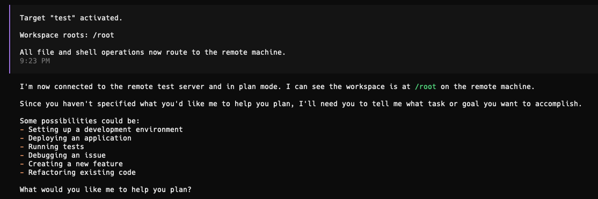

# opencode-rexd-target

`opencode-rexd-target` is an OpenCode plugin that makes selected remote machines feel like local development.

It routes tool calls to [REXD](https://github.com/samiralibabic/rexd), the Remote Execution Daemon, over SSH stdio (`ssh ... rexd --stdio`).

SSH stdio is currently the only supported target transport.



## What is REXD?

[REXD](https://github.com/samiralibabic/rexd) is a lightweight remote execution daemon that exposes process, filesystem, and PTY operations through a JSON-RPC API.

This plugin acts as the OpenCode client layer for REXD targets:

- On active target: tool calls are routed to remote `rexd`
- Without active target: file/shell tools run locally (normal OpenCode behavior)
- PTY tools are currently remote-only and require an active target

## Features

- `/target` command handling: `list`, `use`, `status`, `clear`
- Model-facing target discovery and active-routing context
- Transparent tool routing to remote REXD when a target is active
- Local fallback when no target is active
- Core remote filesystem and shell support: `bash`, `read`, `write`, `list`, `glob`, `grep`
- Remote file parity with native REXD methods: `edit`, `apply_patch`
- PTY support via dedicated remote tools: `pty_spawn`, `pty_write`, `pty_read`, `pty_list`, `pty_kill`

## Requirements

- OpenCode with plugin support
- [REXD](https://github.com/samiralibabic/rexd) installed on target hosts and reachable over SSH
- Target registry at `~/.config/rexd/targets.json`
- REXD v0.1.5+ recommended. `fs.edit` and `fs.patch` require v0.1.3+. `loginShell` compatibility mode requires v0.1.4+.

## Install

Latest release:

```bash
curl -fsSL https://raw.githubusercontent.com/samiralibabic/opencode-rexd-target/main/scripts/install.sh | bash
```

Pinned version:

```bash
curl -fsSL https://raw.githubusercontent.com/samiralibabic/opencode-rexd-target/main/scripts/install.sh | OPENCODE_REXD_TARGET_VERSION=v0.3.16 bash
```

The installer places files in your OpenCode config directory:

- `~/.config/opencode/plugins/rexd-target.js`
- `~/.config/opencode/plugins/rexd-target-tree-sitter.wasm`
- `~/.config/opencode/plugins/rexd-target-tree-sitter-bash.wasm`
- `~/.config/opencode/commands/target.md`

## Post-install setup (required)

1. Ensure every target host runs [REXD](https://github.com/samiralibabic/rexd) `v0.1.5` or newer.
2. Create/update `~/.config/rexd/targets.json` on your local machine.
3. Restart OpenCode so the plugin is reloaded.
4. Run `/target list` and then `/target use <alias>`.

## Configure targets

Example `~/.config/rexd/targets.json`:

```json
{
  "version": 1,
  "targets": {
    "prod": {
      "transport": "ssh",
      "host": "example.com",
      "user": "deploy",
      "loginShell": false,
      "workspaceRoots": ["/srv/app"],
      "defaultCwd": "/srv/app"
    }
  }
}
```

`loginShell` is optional and defaults to `false`.

- `false` (default): predictable non-login shell execution for automation.
- `true`: compatibility mode for legacy targets that require login-shell startup files.

`capabilities.shell` controls whether the plugin exposes remote shell execution. Remote shell commands run with the privileges of the remote `rexd` process user and are not constrained by filesystem RPC root guards. Set `capabilities.shell: false` and `security.allow_shell = false` on the target host when filesystem roots must be the hard security boundary.

The plugin preserves OpenCode's `bash` permission policy. Local fallback uses native-style command families such as `git log *`. Remote permission patterns use the same families inside a target-specific namespace, so an approval for one target cannot authorize local execution or another target. Broad `bash` policies (`allow`, `ask`, or `deny`) still apply; command-specific remote rules use the namespaced pattern shown in OpenCode's approval dialog.

Bash checks walk every Tree-sitter command node, including commands nested in substitutions, groups, loops, and functions. For local execution, each rm operand gets its own permission pattern: literal paths are resolved lexically against the tool cwd and earlier literal cd commands in successful && chains. In v0.3.12, variables and other dynamic operands remain unchanged; ambiguous directory changes stay unresolved. Path normalization does not follow symlinks. Remote checks retain their original source text and target namespace without local path resolution.

In v0.3.13, local rm and cd operands can also use literal same-command-line assignments ($NAME or ${NAME}); plain export assignments are supported. Prefix assignments are command-local and do not replace values expanded by the shell before that command starts. Only literal for-in lists expand to one rm pattern per word. Environment-only names, substitutions, ambiguous writes/control flow, and nonliteral loop lists stay unresolved; nothing is executed to resolve them.

A local resolved rm operand strictly inside the session's verified Git top level (OpenCode's context.worktree) uses rm <options> project:<relative path>. This includes files below .worktrees/<name>/, but not the project root itself, any .git segment, a directory with its own .git entry (including linked-worktree roots), or a glob-bearing path (which cannot be checked for repository markers before expansion). Outside paths remain absolute. The filesystem marker is checked at permission time; /, home, and directories without .git cannot enable project patterns. Resolution is lexical, does not follow symlinks, and is not a filesystem sandbox or a guarantee against concurrent filesystem changes. Remote patterns and /tmp/agents behavior are unchanged.

To allow recursive deletes of project contents while preserving recursive-delete asks elsewhere, append these entries **in this order at the end of permission.bash**, after existing recursive-rm ask rules (OpenCode uses the last matching anchored glob):

```json
{
  "rm -r* project:?*": "allow",
  "rm -R* project:?*": "allow",
  "rm -?r* project:?*": "allow",
  "rm -?R* project:?*": "allow",
  "rm * project:*..*": "ask",
  "rm * project:*$*": "ask",
  "rm * project:*`*": "ask"
}
```

From v0.3.15, whitespace inside one resolved rm operand is percent-encoded in its pattern (%20 for a space, %09 for a tab, %0A for a newline), and a literal % becomes %25. A space in a local rm pattern therefore only separates rm, its options, and its single operand, so `rm -rf "/tmp/agents/x/a b"` yields `rm -rf /tmp/agents/x/a%20b` and `rm -rf "docs/my file.txt"` inside the project yields `rm -rf project:docs/my%20file.txt`. Unresolved operands, whole-line fallbacks, and remote patterns keep their source text, so rules that match several paths in one pattern still apply to them.

From v0.3.16, only a resolved operand proven to be strictly inside the project uses the project: prefix. In local unresolved operands, options, and fallbacks, any `project:` text is written as `project%3A`, so `cd "$X" && rm -rf project:foo` yields `rm -rf project%3Afoo` and still asks under the rules above. A relative file literally named `project:foo` resolves like any other operand, for example to `project:project:foo` inside the project.

The project: prefix is a permission namespace, not a shell path. Existing absolute-path rm rules do not match it; review path-specific policy exceptions before opting in. Multi-operand rm commands still require every generated pattern to be allowed. No configuration is changed automatically.

Subagents resolve target state through their live OpenCode parent-session chain on every operation. The nearest explicit state wins, parent target changes are visible on the child's next operation, and corrupt ancestor state fails closed.

## Usage

In OpenCode:

- `/target list`
- `/target use <alias>`
- `/target status`
- `/target clear`

Active target state is persisted per chat session under `~/.config/opencode/rexd-target/sessions/` and refreshed during normal remote use, so active chats are not pruned as stale.

`/target list` shows each alias together with its SSH endpoint, description, and configured remote working directory. The registry is reloaded when it is used, so edits to `~/.config/rexd/targets.json` do not require an OpenCode restart.

When no target is active, the plugin tells the model to prefer a confidently matched configured target for normal remote administration. Direct SSH remains available for REXD or SSH diagnostics, unconfigured hosts, and intentional further hops. When a target is active, the model receives its alias, endpoint, and configured remote working directory and is reminded that normal shell and file tools are already routed there.

## Updating (existing users)

Update in this order:

1. Update `rexd` on remote target hosts.
2. Update this plugin locally.
3. Restart OpenCode.
4. Reconnect in each chat with `/target use <alias>`.

Update commands:

```bash
# 1) remote hosts
curl -fsSL https://raw.githubusercontent.com/samiralibabic/rexd/main/scripts/install.sh | REXD_VERSION=v0.1.5 bash

# 2) local plugin
curl -fsSL https://raw.githubusercontent.com/samiralibabic/opencode-rexd-target/main/scripts/install.sh | OPENCODE_REXD_TARGET_VERSION=v0.3.16 bash
```

If you update the plugin before `rexd`, remote `edit`/`apply_patch` calls can fail with method-not-found errors on older servers.

If your repo still has an old `.opencode/rexd-state.json` from previous versions, it can be removed.

Note: this plugin now preserves OpenCode UI metadata for `edit` and `apply_patch` so TUI diff rendering works the same way as native tools.

As of `v0.2.5`, plugin `bash` results also mirror output into `metadata.output` so OpenCode's Bash tool panel reliably shows command body output.

## Troubleshooting

- Bash tool shows header but no body output:
  - Update to `v0.2.5` or newer.
  - Restart OpenCode after installing.
  - If needed, clear/reselect target with `/target clear` then `/target use <alias>`.

## Development

```bash
make typecheck
make build
```

## Open-source docs

- License: `LICENSE`
- Contributing: `CONTRIBUTING.md`
- Code of conduct: `CODE_OF_CONDUCT.md`
- Security policy: `SECURITY.md`
